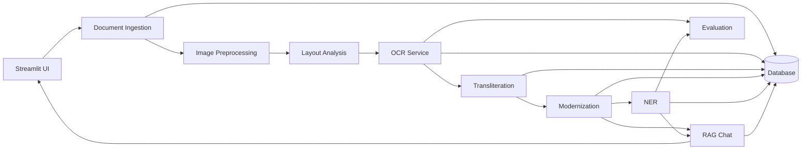

# Architecture Map

**Özet:** UI, servisler, veri katmanı ve yapay zekâ işleme hattı arasındaki üst seviye bağlantıları gösterir.

**Kütüphaneler:** Streamlit, FastAPI, OpenCV, Kraken, SQLAlchemy

**Bağlantılar:** [[Streamlit_UI]], [[FastAPI_API]], [[Database_Model]], [[Processing_Job_State_Machine]]

## Katmanlar

## Ana Veri Akışı
[[Document_Ingestion]] → [[Image_Preprocessing]] → [[Layout_Analysis]] → [[OCR_Service]] → [[Transliteration_Service]] → [[Modernization_Service]] → [[NER_Service]] → [[RAG_Chat_Service]]

## Çapraz Kesitler
- [[Audit_Log]]
- [[Security_Model]]
- [[Model_Registry]]
- [[Evaluation_Service]]
- [[Export_Service]]

## Mermaid

## Doğrulama Notu
Bu harita başlangıç hipotezidir. İlk INGEST sırasında gerçek codebase ile doğrulanmalı ve statüler güncellenmelidir.
