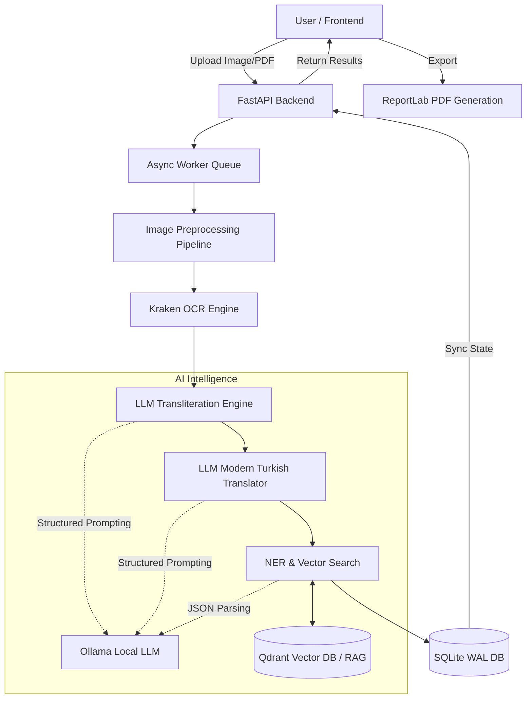

<h1 align="center">Intelligent Ottoman Turkish Assistant</h1>

<p align="center">
  <em>An end-to-end AI-powered digitalization platform for Ottoman Turkish historical archives.</em>
</p>

<p align="center">
  
  
  
  
  
  
  
  
</p>

---

## 📖 Vision & Mission
Millions of Ottoman documents are waiting in archives to be digitized, transcribed, and analyzed. **Intelligent Ottoman Turkish Assistant** is designed to bridge the gap between historical researchers and raw archival materials. 

This platform seamlessly converts handwritten or printed Ottoman script into digital text, transliterates it into the Latin alphabet, translates it into Modern Turkish, and enriches it with Named Entity Recognition (NER) and Historical Context Analysis using state-of-the-art Local LLMs and RAG architectures.

## 🚀 Key Features
- **Advanced OCR (Optical Character Recognition):** Integrated with Kraken and custom image preprocessing pipelines to extract text from heavily damaged historical documents.
- **AI-Powered Transliteration & Modernization:** Powered by Local LLMs (Ollama + Qwen) structured with strict guardrails and JSON schemas to prevent hallucinations.
- **RAG & Contextual Intelligence:** Uses Qdrant / FAISS Vector DBs for retrieving verified historical facts, enriching extracted entities without inventing facts.
- **Production-Ready UI:** Sleek, responsive, and intuitive Dashboard built with Next.js App Router and Custom React Hooks for optimal state management.
- **One-Click Export:** Instantly export analyzed documents, including side-by-side original script, transliteration, and AI insights, into beautifully formatted **PDF**, JSON, or CSV reports.
- **DevOps & Microservices:** Fully dockerized (Frontend, Backend, and Async Workers) with resilient SQLite WAL mechanisms to support concurrent operations.

## 🧠 System Architecture



## 🛠️ Quick Start (Hızlı Başlangıç)

With our complete microservice orchestration, you can run the entire ecosystem locally or in the cloud using a single command.

### Prerequisites
- [Docker](https://www.docker.com/) and [Docker Compose](https://docs.docker.com/compose/) installed on your machine.

### Installation

1. **Clone the repository:**
   ```bash
   git clone https://github.com/your-username/ottoman-turkish-assistant.git
   cd ottoman-turkish-assistant
   ```

2. **Spin up the environment:**
   ```bash
   docker-compose up -d --build
   ```

3. **Access the application:**
   - **Frontend (UI):** [http://localhost:3000](http://localhost:3000)
   - **Backend API (Swagger UI):** [http://localhost:8000/docs](http://localhost:8000/docs)

*(Note: Data volumes such as SQLite DB and export files are mounted to the host machine automatically to ensure data persistence across container reboots.)*

## 📁 Repository Structure
```text
.
├── backend/            # FastAPI, Database (SQLAlchemy), OCR & AI Services
│   ├── app/            # Application logic, routers, dependencies
│   ├── worker.py       # Asynchronous background job processor
│   ├── Dockerfile      # Python 3.11 Backend Environment
│   └── requirements.txt
├── frontend/           # Next.js UI, React Hooks, Tailwind CSS
│   ├── src/app/        # App router, pages, and components
│   ├── Dockerfile      # Node 20 Multi-stage Standalone Build
│   └── package.json
└── docker-compose.yml  # Microservices orchestrator
```

## 🛡️ License
This project is proprietary and intended for specialized historical research and archival digitization. All rights reserved.
